# Star Dash — Lab 07
**Roll Number:** BSCS25071  
**Course:** CS-464 Game Development (Lab 07)  
**Unity Version:** Unity 6 (6000.3.24f1)  
## Demo Video
You can watch the complete walkthrough of all 10 screens, button interactions, and navigation transitions here:  
[Watch Demo Video](https://drive.google.com/file/d/1V5RDsWyHJ0y0YZzt9VUNt50_KUckVOnU/view?usp=sharing)
## Design Overview
- **Target Resolution & Scaling:** Built for a **1080 × 1920** portrait mobile screen. The Canvas uses `Scale With Screen Size` (match set to `0.5`) along with a custom `SafeArea` script so the UI fits properly on different phone aspect ratios and notched displays.
- **Color Palette:** Used a dark navy background (`#0B132B`) so bright UI elements stand out easily. Primary actions like `PLAY` and `NEXT LEVEL` use warm amber (`#FFB400`), secondary buttons use royal blue (`#4B5BFF`), and back/destructive actions use crimson (`#F2435D`).
- **Typography & Layout:** Used TextMeshPro (`TMP`) with bold headings for titles and clean labels for buttons and counters so everything stays readable on smaller mobile screens.
- **Transitions & Feedback:** Wrote a custom `UIManager` with a navigation history stack (`Open`, `Back`, and `OpenAndClearHistory`), paired with `UIScreen` fade/scale transitions and `ButtonFeedback` press animations.
## Screen Breakdown & Greyscale Check (10 Screens)
To make sure the UI does not rely on color alone, every screen was checked in greyscale to verify contrast, button visibility, and text readability.
### 1. Main Menu (`Screen_MainMenu`)
| Colour | Greyscale |
| :---: | :---: |
| 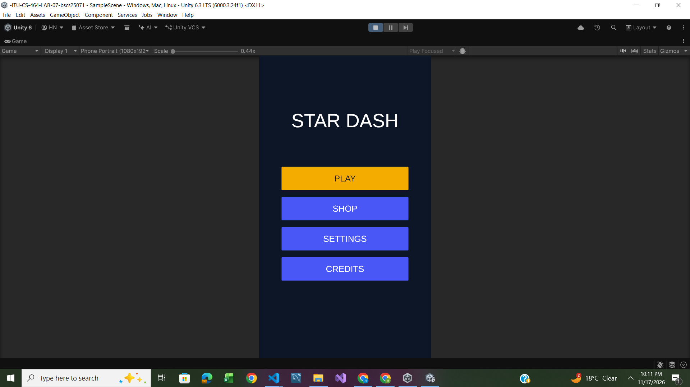 | 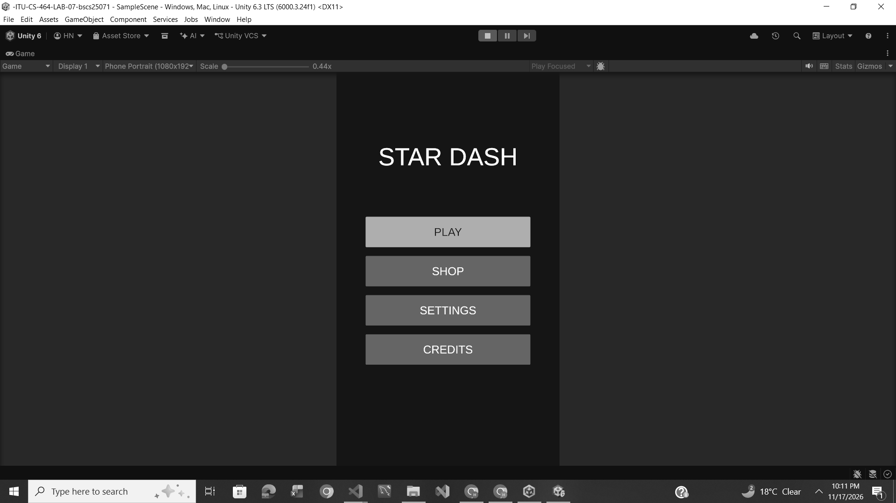 |
- **Flow & Purpose:** The starting screen of the game with the `STAR DASH` title and four main buttons: `PLAY`, `SHOP`, `SETTINGS`, and `CREDITS`.
- **Greyscale Check:** The `PLAY` button clearly stands out from the secondary buttons even without color. No change was needed.
### 2. Mode Select (`Screen_ModeSelect`)
| Colour | Greyscale |
| :---: | :---: |
| 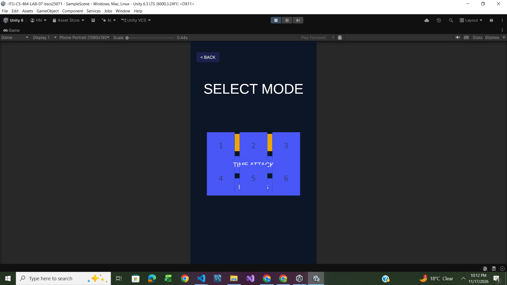 | 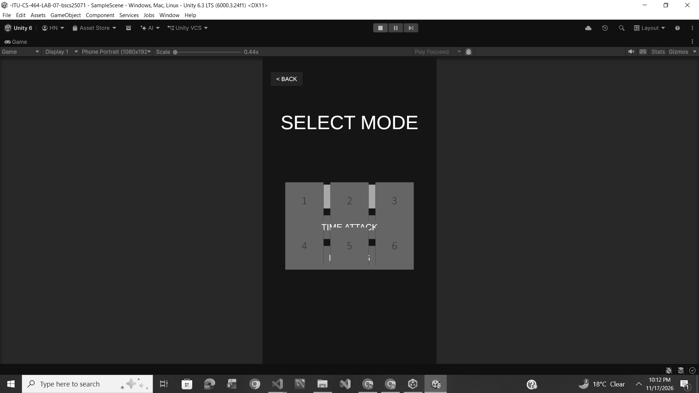 |
- **Flow & Purpose:** Lets the player pick between `CLASSIC`, `TIME ATTACK`, and `ENDLESS` modes, with a `BACK` button returning to the Main Menu.
- **Greyscale Check:** Button borders and labels remain easy to tell apart. No change was needed.
### 3. Level Select (`Screen_LevelSelect`)
| Colour | Greyscale |
| :---: | :---: |
| 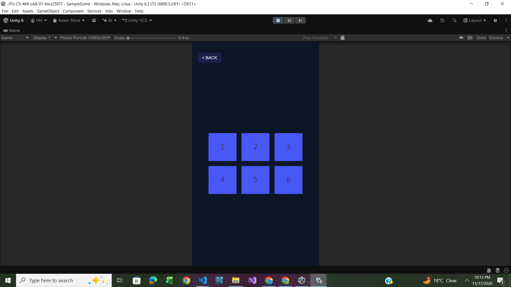 |  |
- **Flow & Purpose:** Displays a 6-level grid (`Level 1` to `Level 6`) that loads into the gameplay HUD, along with a `BACK` button.
- **Greyscale Check:** Number labels and grid spacing stay clear in greyscale. No change was needed.
### 4. Gameplay HUD (`Screen_HUD`)
| Colour | Greyscale |
| :---: | :---: |
| 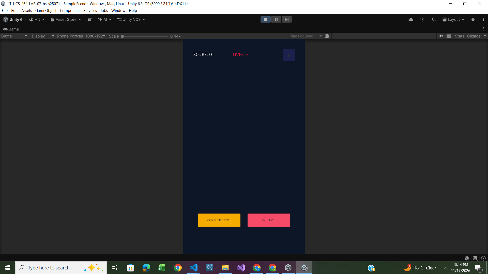 | 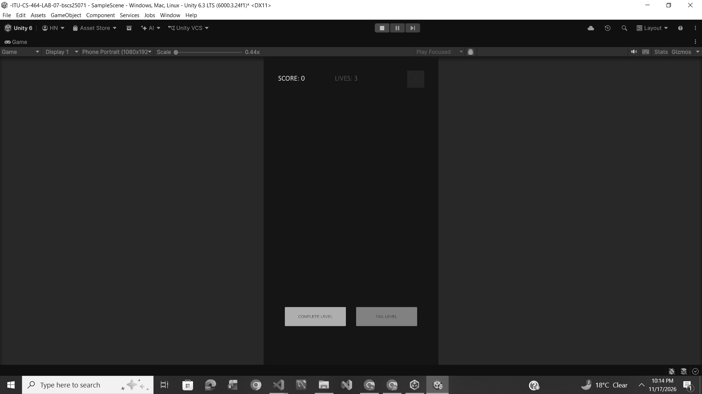 |
- **Flow & Purpose:** Shows the player's current `SCORE`, `LIVES`, and a `PAUSE` button at the top, plus `COMPLETE LEVEL` and `FAIL LEVEL` test triggers at the bottom to test win/lose flows.
- **Greyscale Check:** Adjusted text and button contrast against the background so HUD values stay readable during gameplay.
### 5. Pause Popup (`Screen_Pause`)
| Colour | Greyscale |
| :---: | :---: |
| 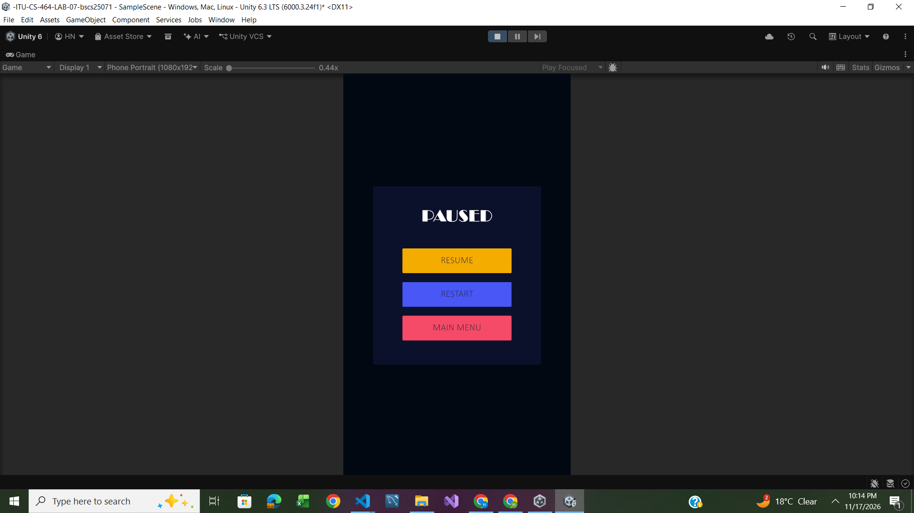 |  |
- **Flow & Purpose:** Overlay popup triggered from the HUD with options to `RESUME`, `RESTART`, or return to `MAIN MENU` (clearing navigation history).
- **Greyscale Check:** The popup card separates cleanly from the dimmed background. No change was needed.
### 6. Victory Popup 
| Colour | Greyscale |
| :---: | :---: |
|  | 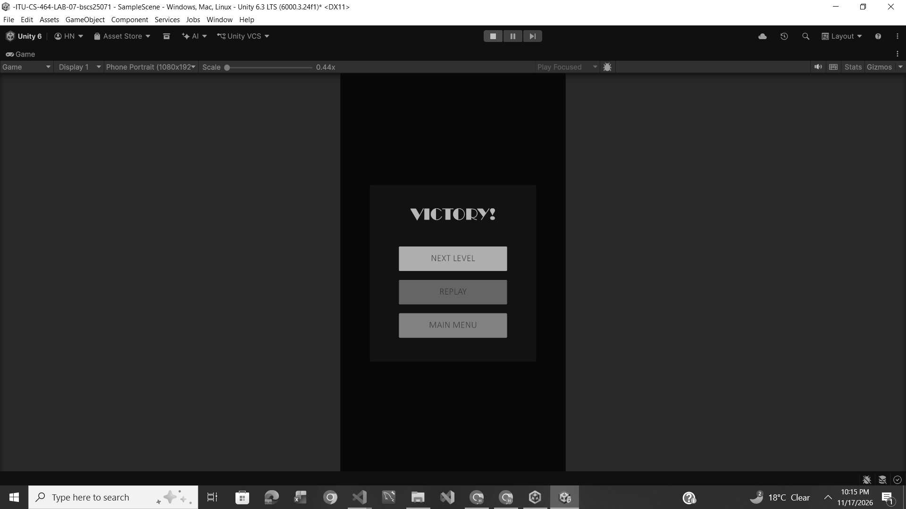 |

- **Flow & Purpose:** Appears when a level is completed, showing the `VICTORY!` header, score summary, `NEXT LEVEL`, and `MAIN MENU`.
- **Greyscale Check:** Text contrast inside the card remains crisp. No change was needed.
### 7. Game Over Popup 
| Colour | Greyscale |
| :---: | :---: |
| 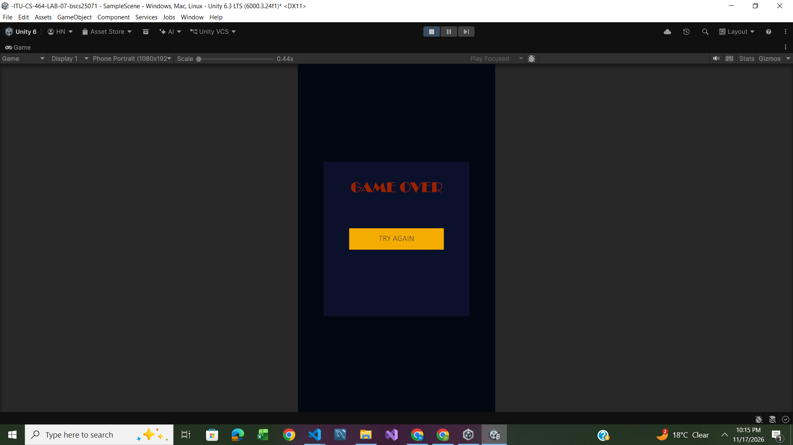 | 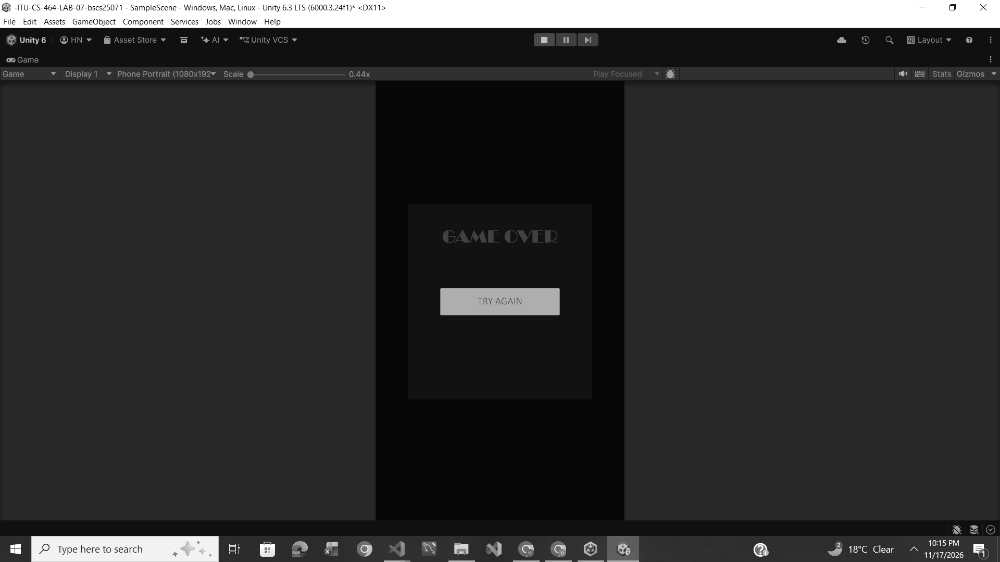 |
- **Flow & Purpose:** Appears when a level is failed, showing `GAME OVER`, final score, `RETRY`, and `MAIN MENU`.
- **Greyscale Check:** Button labels and hierarchy remain clear without relying on red color cues alone. No change was needed.
### 8. Item Shop
| Colour | Greyscale |
| :---: | :---: |
| 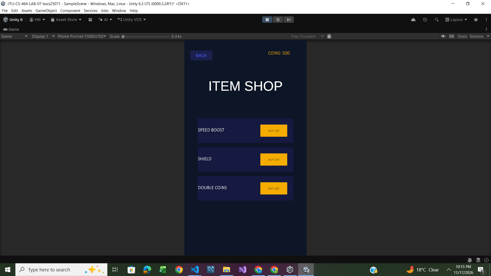 | 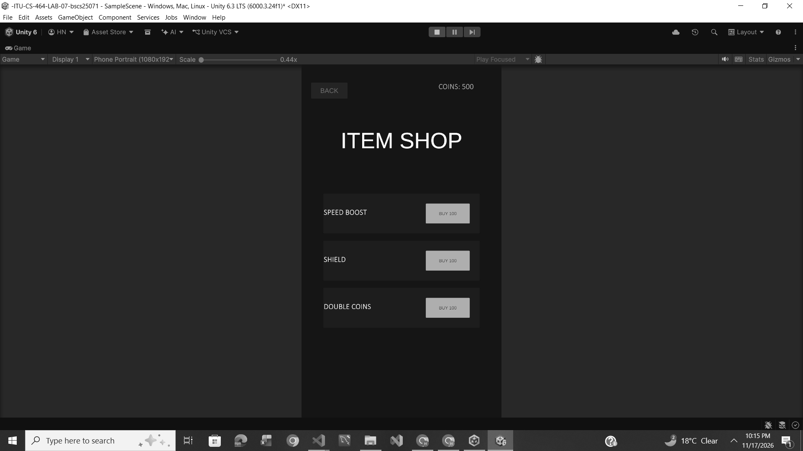 |
- **Flow & Purpose:** Shows the player's coin balance (`COINS: 500`), three upgrade cards (`SPEED BOOST`, `SHIELD`, `DOUBLE COINS`) with `BUY 100` buttons, and a `BACK` button.
- **Greyscale Check:** Updated the top-left `BACK` button label and brightness so it is clearly visible against the dark background.
### 9. Settings 
| Colour | Greyscale |
| :---: | :---: |
| 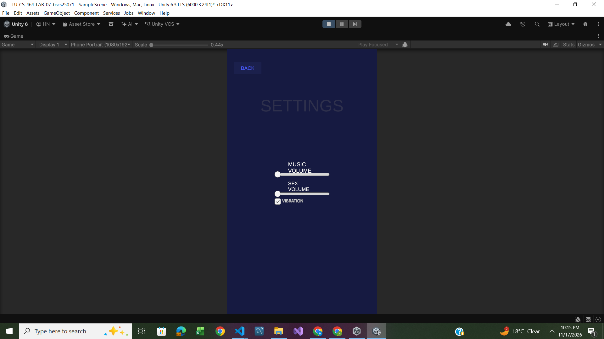 | 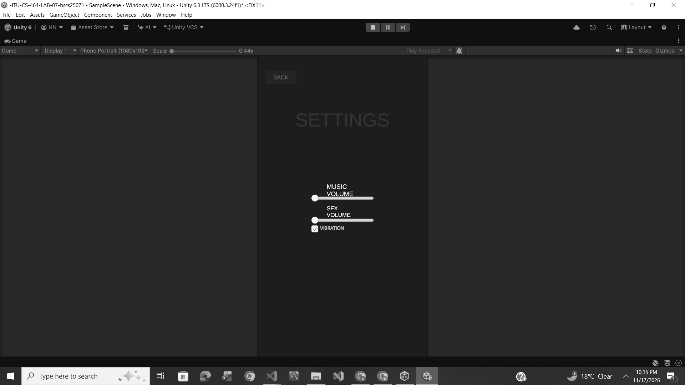 |

- **Flow & Purpose:** Provides `MUSIC VOLUME` and `SFX VOLUME` sliders, a `VIBRATION` toggle, and a `BACK` button.
- **Greyscale Check:** Changed the `SETTINGS` title color to pure white and added a visible `BACK` button after noticing the header blended too much into the background.
### 10. Credits
| Colour | Greyscale |
| :---: | :---: |
| 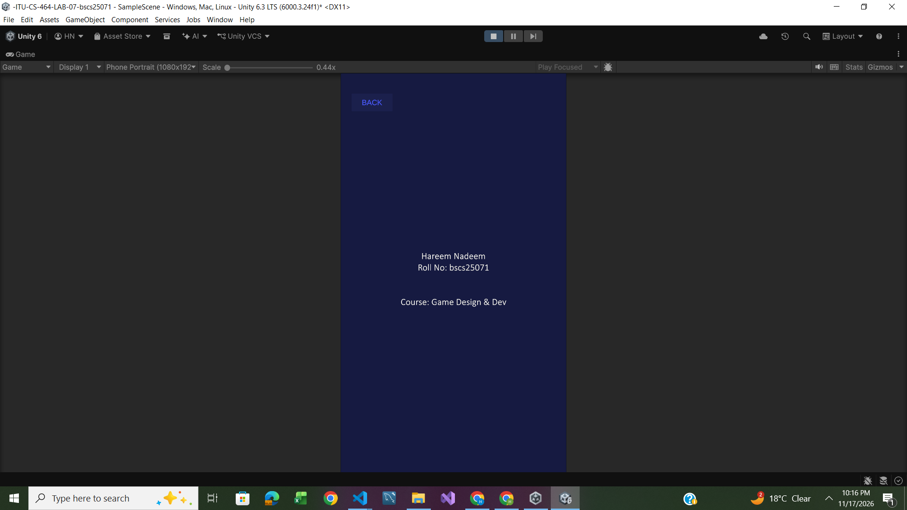 | 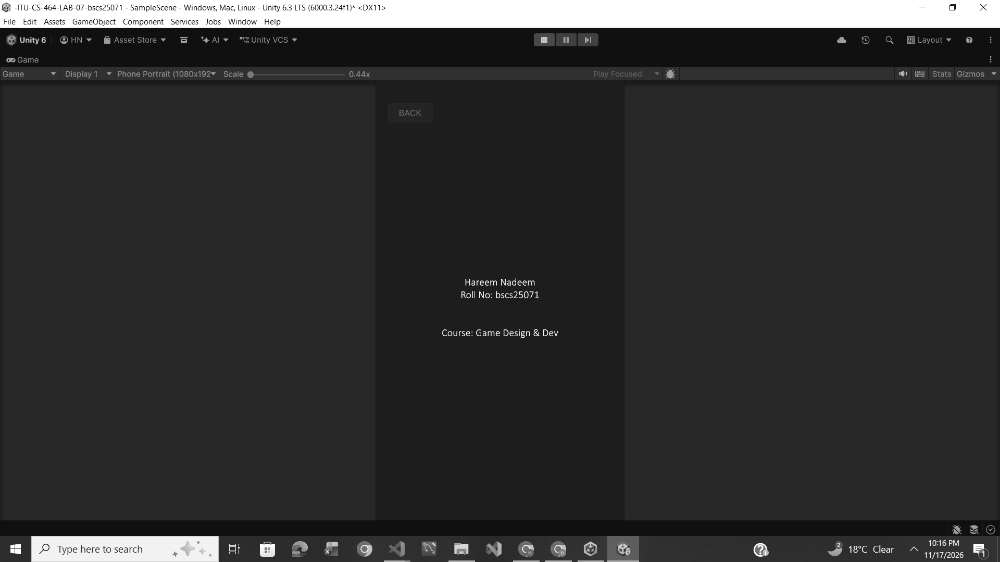 |
- **Flow & Purpose:** Displays student/developer details (`BSCS25071`), course info, and a `BACK` button.
- **Greyscale Check:** Text readability and `BACK` button contrast look good. No change was needed.
## How to Run the Project
1. Clone this repository to your computer:
   ```bash
   git clone [https://github.com/bscs25071-jpg/-ITU-CS-464-LAB-07-bscs25071.git](https://github.com/bscs25071-jpg/-ITU-CS-464-LAB-07-bscs25071.git)
